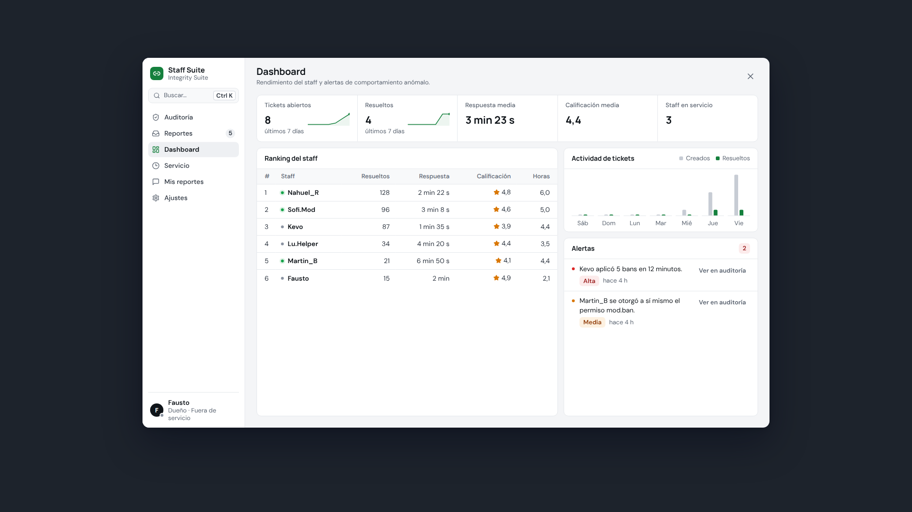
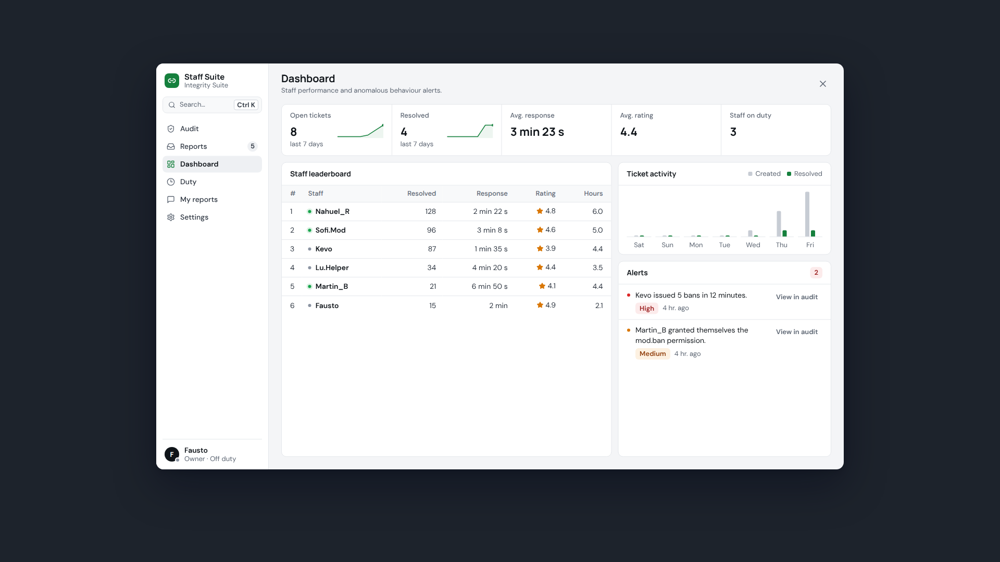

# Staff Integrity Suite (FiveM)

**ES** · [EN](#english)

**El único que audita a tu staff.** Reportes, moderación dentro del ticket, duty y un audit log con hash-chain SHA-256 que delata cualquier edición o borrado. Español-first, también en inglés.



Reporte → claim → resolve, con el estado visible para el jugador:


Versión **0.2.0**. [Cambios y guía de actualización](CHANGELOG.md#020--español).

## Funciones de Core

- **Reportes/tickets:** `/report`, máquina de estados (abierto → reclamado → en curso → resuelto → cerrado, reabrir), claim con lock, transferencia.
- **Chat del ticket:** el jugador sigue el hilo público en Mis reportes. El staff puede agregar notas internas y transferir el ticket.
- **Moderación dentro del ticket.** Goto, bring, freeze, unfreeze, heal, kick, ban, warn, spectate y revive con permisos y auditoría. Los bans se comprueban al conectar.
- **Duty:** `/duty`, horas y sesiones por staff.
- **Panel NUI** (`F6`): auditoría, reportes, dashboard, servicio y ajustes; cada uno ve solo lo que su rango permite.
- **Auditoría verificable:** cada acción queda encadenada con SHA-256; verificación desde consola, panel o export.
- **Anclaje off-box:** archivo `audit_export.log` + webhook de Discord.
- **Permisos por rango** (least-privilege, capabilities), con detección automática de Qbox, QBCore y ESX, o ACE `staff_suite.<rango>` en standalone.
- **Persistencia:** archivo JSON sin dependencias, u oxmysql (MySQL/MariaDB).
- **ES/EN** con locales abiertos.
- **Captura externa.** Eventos de ESX, QBCore, Qbox y txAdmin según los hooks que expone cada recurso.
- **Tickets F2.** Respuestas predefinidas, calificación del jugador y captura de evidencia con `screenshot-basic`.

No reemplaza a txAdmin: noclip, god y spawn siguen ahí.

## Ediciones

| Edición | Precio | Incluye |
|---|---|---|
| **Lite** | $0 | Reportes básicos, auditoría con hash-chain de lo que pasa por el panel, visor. |
| **Core** | $29–39 pago único | Suite completo: reportes avanzados, moderación en ticket, duty/analytics, auditoría unificada con export off-box, permisos por rango, multi-framework. |
| **Integrity Pro** | $8–12/mes por server | **(próximamente)** Inventario de permisos cross-system, permisos con vencimiento, flags de anomalías, case files, apelaciones, dashboard del dueño. |

### Lite vs Core

| Función | Free Lite | Core |
|---|---|---|
| Reportes y tickets | `/report`, cola, reclamar, resolver, cerrar, reabrir y chat público en Mis reportes | Flujo de Lite más prioridades, notas internas, transferencias, respuestas predefinidas, calificación y evidencia |
| Auditoría | Cadena SHA-256 de acciones del panel, visor y verificación | Todo Lite, captura externa, anclajes y exportación de auditoría |
| Moderación, turnos y estadísticas | — | Acciones desde el ticket, duty y analytics |
| Integraciones y acceso | Standalone, un permiso ACE para staff | Standalone, ESX, QBCore y Qbox con rangos y capabilities. API de exports para otros recursos |
| Persistencia | Archivo JSON | JSON u oxmysql con respaldo JSON |
| Distribución | Gratis para GitHub/foro, licencia MIT, código Lua editable | Paquete para Tebex y Cfx Asset Escrow |

Free Lite está preparado para distribución gratuita por GitHub y foro bajo licencia MIT. Core se empaqueta para Tebex con Cfx Asset Escrow. [Comparar ediciones](docs/es/ediciones.md).

## Requisitos

- FXServer reciente (Lua 5.4).
- Opcional: oxmysql + MySQL/MariaDB.
- Opcional: ESX Legacy, QBCore o Qbox (se detectan solos con `Config.Framework = 'auto'`). Sin framework, permisos por ACE.

## Paquetes de release

En Linux con Bash, Node.js 24 y npm, Lua 5.4 y `zip`, ejecutá `./scripts/build-release.sh --edition lite` para generar `dist/staff_suite_lite-<version>.zip` o `./scripts/build-release.sh --edition core` para generar `dist/staff_suite-<version>.zip`. Ambos ZIP tienen raíz `staff_suite/`, usan la versión de `fxmanifest.lua` y se publican como artifacts de GitHub Actions.

En Core, `escrow_ignore` mantiene editables `config.lua`, `server/config.lua`, `locales/*.lua` y `sql/*.sql`. Los bridges quedan protegidos porque la selección de framework y los mapeos de permisos y jobs se ajustan en la configuración abierta. Cfx deja abierta la NUI compilada.

## Documentación

- [Instalación](docs/es/instalacion.md)
- [Configuración (`config.lua` y `server/config.lua`)](docs/es/configuracion.md)
- [Rangos y permisos](docs/es/permisos.md)
- [Panel (NUI)](docs/es/panel.md)
- [Auditoría: export y verificación](docs/es/auditoria.md)
- [FAQ y solución de problemas](docs/es/faq.md)
- [QA y E2E en FXServer](docs/es/qa.md)

## Tests

```
lua5.4 tests/run_all.lua
cd ui && npm ci && npm test
FIVEM_LICENSE_KEY=... scripts/e2e-fxserver.sh   # E2E en FXServer real, ver docs/es/qa.md
```

---

## English

**The only one that audits your staff.** Reports, in-ticket moderation, duty and an audit log with a SHA-256 hash chain that exposes any edit or deletion. Spanish-first, also in English.



Report → claim → resolve, with the status visible to the player (mock demo data, in Spanish):


Version **0.2.0**. [Changelog and upgrade guide](CHANGELOG.md#020--english).

### Core features

- **Reports/tickets:** `/report`, state machine (open → claimed → in progress → resolved → closed, reopen), locked claim, transfer.
- **Ticket chat:** players follow the public thread in My reports. Staff can add internal notes and transfer the ticket.
- **In-ticket moderation.** Goto, bring, freeze, unfreeze, heal, kick, ban, warn, spectate and revive with permission checks and audit entries. Bans are checked on connection.
- **Duty:** `/duty`, hours and sessions per staff member.
- **NUI panel** (`F6`): audit, reports, dashboard, duty and settings; each person only sees what their rank allows.
- **Verifiable audit log:** every action is chained with SHA-256; verify from console, panel or export.
- **Off-box anchoring:** `audit_export.log` file + Discord webhook.
- **Rank-based permissions** (least privilege, capabilities), with automatic Qbox, QBCore and ESX detection, or `staff_suite.<rank>` ACEs in standalone.
- **Persistence:** dependency-free JSON file, or oxmysql (MySQL/MariaDB).
- **ES/EN** with open locales.
- **External event capture.** Staff Suite listens to supported ESX, QBCore, Qbox and txAdmin events.
- **F2 tickets.** Canned replies, player ratings and evidence capture with `screenshot-basic`.

It does not replace txAdmin: noclip, god and spawning stay there.

### Editions

| Edition | Price | Includes |
|---|---|---|
| **Lite** | $0 | Basic reports, hash-chain audit of everything done through the panel, viewer. |
| **Core** | $29–39 one-time | Full suite: advanced reports, in-ticket moderation, duty/analytics, unified audit log with off-box export, rank permissions, multi-framework. |
| **Integrity Pro** | $8–12/month per server | **(coming soon)** Cross-system permission inventory, expiring permissions, anomaly flags, case files, appeals, owner dashboard. |

### Lite vs Core

| Feature | Free Lite | Core |
|---|---|---|
| Reports and tickets | `/report`, queue, claim, resolve, close, reopen and public chat in My reports | Lite workflow plus priorities, internal notes, transfers, canned replies, ratings and evidence |
| Audit | SHA-256 chain for panel actions, viewer and verification | Everything in Lite, external event capture, anchoring and audit export |
| Moderation, duty and analytics | — | In-ticket moderation, duty and staff analytics |
| Integrations and access | Standalone with a single staff ACE permission | Standalone, ESX, QBCore and Qbox with ranks and capabilities. Exports API for other resources |
| Storage | JSON file | JSON or oxmysql with a JSON backup |
| Distribution | Free for GitHub and forum distribution, MIT-licensed, editable Lua code | Package for Tebex and Cfx Asset Escrow |

Free Lite is packaged under MIT for free distribution on GitHub and the forum. Core is packaged for Tebex with Cfx Asset Escrow. [Compare editions](docs/en/editions.md).

### Requirements

- Recent FXServer (Lua 5.4).
- Optional: oxmysql + MySQL/MariaDB.
- Optional: ESX Legacy, QBCore or Qbox (auto-detected with `Config.Framework = 'auto'`). Without a framework, permissions come from ACE.

### Release packages

On Linux with Bash, Node.js 24 and npm, Lua 5.4, and `zip`, run `./scripts/build-release.sh --edition lite` for `dist/staff_suite_lite-<version>.zip` or `./scripts/build-release.sh --edition core` for `dist/staff_suite-<version>.zip`. Both ZIPs have a top-level `staff_suite/` folder, use the version from `fxmanifest.lua`, and are uploaded as GitHub Actions artifacts.

In Core, `escrow_ignore` keeps `config.lua`, `server/config.lua`, `locales/*.lua` and `sql/*.sql` editable. The bridges stay protected because framework selection and permission and job mappings are managed in the open configuration. The compiled NUI stays open under Cfx.

### Documentation

- [Installation](docs/en/installation.md)
- [Configuration (`config.lua` and `server/config.lua`)](docs/en/configuration.md)
- [Ranks and permissions](docs/en/permissions.md)
- [Panel (NUI)](docs/en/panel.md)
- [Audit: export and verification](docs/en/audit.md)
- [FAQ and troubleshooting](docs/en/faq.md)
- [QA and FXServer E2E](docs/en/qa.md)

### Tests

```
lua5.4 tests/run_all.lua
cd ui && npm ci && npm test
FIVEM_LICENSE_KEY=... scripts/e2e-fxserver.sh   # real FXServer E2E, see docs/en/qa.md
```
